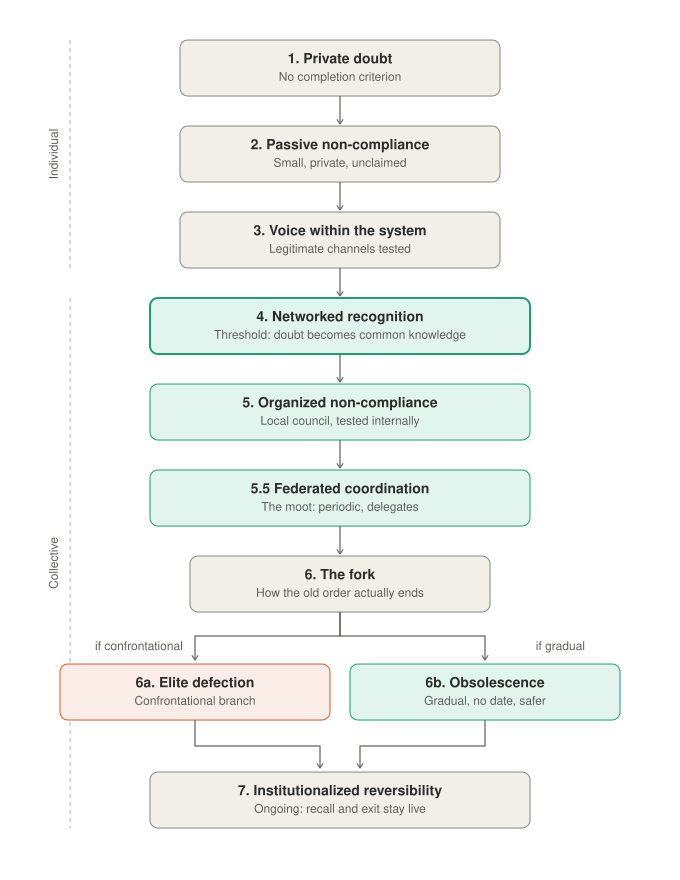

# Roadmap to Independence — From Idea to Belief to Obsolescence

## Abstract / TL;DR

Political order rests on belief, not force alone. Borders, governments, and institutions persist because enough people accept them as legitimate — not because they can't be physically challenged. When that acceptance erodes, the structure becomes vulnerable regardless of its material strength; when it holds, no amount of external pressure moves it. This document is a roadmap for that erosion and what replaces it — not a plan for revolution, but a job description for every stage between one person's private doubt and a fully self-governing federation of communities.

The roadmap has three parts, matching the title. **Idea**: this document itself — a shareable artifact that can move from person to person, doing at document-scale what stage one does at belief-scale. **Belief**: what happens in an individual reader who recognizes their own doubt in these pages, and the private, low-risk, non-performative steps available before any collective exists to join. **Obsolescence**: the collective endgame — not a declared independence, not a date, not a flag, but the point at which the old order has quietly stopped being necessary because federated local structures already handle what people actually depend on day to day.

Three commitments run through every stage:

- **Individual and collective are not the same thing, and confusing them is the most common failure mode.** Private belief is not a movement. A movement is not yet an institution. Each transition has its own job description and its own exit condition, and skipping ahead — declaring a "we" before one exists, designing a constitution before there's a base to test it — invites either isolated suppression or later capture.
- **The goal is not to replace one administration with another under a different name.** Elite substitution wearing the old order's clothes, or the new order's, is a failure condition this roadmap treats as seriously as failure to act at all. What has to survive every transition is the population's standing, low-cost ability to withdraw consent again — not a one-time act of overthrow.
- **Slow and undramatic is the safer path, by design.** This roadmap does not aim at a confrontation with the old order or a moment of external recognition. It aims at obsolescence: a gradual shift in which the functions people rely on migrate to structures they built, tested, and can still recall and exit from, until the old system is simply no longer load-bearing. Recognition, if it is ever sought, is a tactical decision taken later — never the objective.

## How to read this document

The roadmap has two axes, not one.

**The vertical axis** is time and scale — the sequence of stages from private doubt to obsolescence. Each stage has an entry condition, a job, an exit condition, and a specific pitfall it guards against. A stage is not complete because someone declares it complete; it is complete when its exit condition is actually true.

**The horizontal axis** is participation intensity within any given stage — passive to active. Not everyone at a stage is doing the same thing, and that's not a failure. Most people at any stage will sit toward the passive end; a smaller core carries the active load. The job of organizing is to move people one notch along this axis, not to demand a leap from bystander to full-time organizer in one step. A stage that looks achieved on paper but is entirely passive is nominal, not functional — this is how movements get hollowed out from within without any external suppression at all.

Passive participation is not automatically a deficiency. A passive participant with real information and a real, standing exit or recall right is legitimately positioned. A passive participant who is being managed, informed-but-not-consulted, or placated while decisions happen elsewhere is a capture symptom, not a low commitment level. The difference is whether their passivity is a choice with real options attached, or a condition imposed on them.

---

## The structure at a glance

## The stages

### Stage 1 — Private doubt
**Register:** Individual. **Entry condition:** none — this is a standing background condition, not a triggered state.
**Job:** Nothing external. Internal reassessment only.
**Exit condition:** Not applicable — this stage has no completion criterion; many people remain here indefinitely.
**Pitfall guarded against:** Commentators and movements alike routinely mistake widespread stage 1 for stage 4 ("support is growing"). The first job of this roadmap is teaching the distinction between *I believe this* and *we are doing something about this*.

*Passive → active spectrum:*
- Passive: unexamined discomfort, not yet named even to oneself.
- Active (still stage 1): naming the doubt clearly, privately, without acting on it.

### Stage 2 — Passive non-compliance
**Register:** Individual. **Entry condition:** doubt has become specific enough to act on quietly.
**Job:** Small, private, unclaimed acts of withdrawal.
**Exit condition:** None required. Many people never leave this stage, and the roadmap does not ask them to.
**Pitfall:** Performing this stage publicly before any collective cover exists invites isolated retaliation for no strategic gain. The job description explicitly excludes seeking recognition.

*Passive → active spectrum:*
- Passive: minor personal disengagement, unnoticed by anyone.
- Active: consistent, deliberate withdrawal, still unclaimed and undocumented.

### Stage 3 — Voice within the system
**Register:** Individual, engaging existing institutions.
**Entry condition:** a belief that the existing channel might still respond.
**Job:** Use legitimate available channels — petitions, complaints, formal participation — genuinely, not as theater.
**Exit condition:** The channel visibly fails to respond proportionately. This is diagnostic information for the roadmap, not a defeat.
**Pitfall:** Mistaking institutional acknowledgment ("your concern is noted") for resolution, which pacifies people back down to stage 1.

*Passive → active spectrum:*
- Passive: signs a petition someone else organized.
- Active: initiates the complaint, organizes the petition, represents the grievance formally.

### Stage 4 — Networked recognition *(threshold: individual becomes collective)*
**Register:** The hinge stage. **Entry condition:** enough stage 1–3 individuals exist that they could, in principle, find each other.
**Job:** Make private doubt visible to other doubters, honestly — documentation and communication, not organizing yet, and not architecture.
**Exit condition:** A real, roughly-known base exists and *knows that it exists* — common knowledge achieved, not just aggregate sentiment.
**Pitfall:** The single most dangerous moment in the whole roadmap — the temptation to jump straight to designing stage 6's institutions here, before anyone knows how large or what kind of "we" actually exists. This stage's job description explicitly excludes constitution-writing.

*Passive → active spectrum:*
- Passive: reads or watches others express the same doubt; says nothing themselves.
- Active: documents and shares their own doubt publicly, in a form others can find and recognize themselves in.

### Stage 5 — Organized non-compliance
**Register:** Collective, local. **Entry condition:** a known local base exists (stage 4 complete).
**Job:** Build tested, reversible, local coordination — a small community with its own local council — sized to what is actually known to exist, not to an imagined larger movement.
**Exit condition:** The local structure has survived a real internal disagreement and at least one real test of its own decision or recall mechanism — tested in practice, not just designed on paper.
**Pitfall:** Locking in permanent federation-level architecture before any single local unit has stress-tested its own mechanisms. Premature scaling is premature capture's precondition.

*Passive → active spectrum:*
- Passive: attends local meetings, doesn't hold a role.
- Active: holds a recallable local role; convenes meetings; is directly accountable to the local base.

### Stage 5.5 — Federated coordination *(the moot)*
**Register:** Collective, inter-community. **Entry condition:** multiple stage-5 local units exist, each having met its own exit condition independently.
**Job:** Coordinate only what genuinely cannot be handled locally — dispute resolution between units, resource-sharing, shared infrastructure — through delegates sent from tested local units, gathering periodically rather than sitting as a standing body.
**Exit condition:** The federation-level body has survived at least one real disagreement between member units without either side leaving, and has renewed or revoked at least one delegate's mandate in practice.
**Pitfall:** This is the point where Ostrom's "nested enterprise" either stays genuinely nested or quietly becomes a new center. The moot's periodic, non-standing character is itself a safeguard — power that lapses by default between sessions is structurally harder to accrete than power that sits continuously.

*Passive → active spectrum:*
- Passive: local unit sends proxy views to the moot via its delegate.
- Active: attends and negotiates at the moot in person; defends and reports back on the mandate held.

## Stage 6 — The fork

Once stage 5.5's federated structures are functioning and tested, the roadmap no longer has a single path forward. What happens next depends on how the old order's authority actually ends — and the two ways this can happen produce very different demands on everything that follows. One branch is confrontational: the old order still wants to hold power and loses the capacity to, through the defection of the people who enforce it. The other is gradual: the old order isn't defeated at all, it simply stops being necessary, because the federated structures already do what people depend on. These are not stages of the same process happening one after another — they are alternative routes, and the roadmap treats which one occurs as largely outside anyone's direct control, arrived at rather than chosen. What can be chosen, in advance, is which branch stage 5.5's structures are built to be ready for.

### Stage 6a — Elite / enforcer defection *(confrontational branch)*
**Register:** Collective, contested. **Entry condition:** the old order's cost of enforcing compliance now exceeds its capacity or will to pay it.
**Job (movement side):** Readiness — stage 5/5.5 structures able to absorb sudden opportunity without a vacuum being filled by whoever moves fastest.
**Exit condition:** The vacuum is filled by structures accountable to stage 5/5.5's base, not by whichever actor was simply positioned to grab it.
**Pitfall:** Capture in its fullest form — a narrow group claiming to represent the base, using structures the base never actually tested. Historically the more common outcome than not.

### Stage 6b — Obsolescence *(the slower, safer branch — no confrontation, no date)*
**Register:** Collective, gradual. **Entry condition:** stage 5.5 federated structures are already handling real day-to-day functions people depend on.
**Job:** Keep extending the range of functions — provisioning, dispute resolution, security, legitimacy of everyday transactions — served by the federated structures, until the old order is discovered to be governing very little.
**Exit condition:** No single event. The measurable proxy: what fraction of the concrete functions people actually rely on day to day now run through the federated structures rather than the old system.
**Pitfall:** Mistaking visible, uncontested *control* for *legitimacy* — an occupier's structure can also run everything unopposed. What distinguishes genuine obsolescence from mere successful capture is that the structure people now depend on is one they built and can still recall or exit from, not merely the one currently in charge.

### Stage 7 — Institutionalized reversibility *(ongoing, never complete)*
**Register:** Everyone, permanently.
**Job:** Keep exit, recall, and nested authority genuinely live and invocable at every layer, indefinitely.
**Exit condition:** None. This stage has to keep running or the whole roadmap reverts to stage 1 against a new administration.
**Pitfall:** Treating the design as finished once written down, rather than as a hypothesis still being tested every time someone actually tries to invoke a recall or exit clause. Recognition from outside actors, if ever sought, is a tactical decision taken here — never the objective the roadmap was built around.

---

## A note on failure modes, not just stages

Every stage above has a companion failure mode rather than a single generic warning. None of these are solved once. Each has to be actively guarded against for as long as the roadmap is in use.

**Over-signaling (stage 2).** Passive non-compliance is meant to stay private and unclaimed. The failure happens when someone treats a small personal act of withdrawal as a statement and performs it publicly, before any collective exists to give that statement cover or meaning. The result is an isolated individual absorbing the full cost of visibility with no strategic gain, because there is no stage 4 base yet for the signal to reach or protect them.

**False resolution (stage 3).** A legitimate channel — a complaint, a petition, a formal process — responds with acknowledgment rather than change: the concern is "noted," a meeting is held, a review is promised. This looks like progress and is mistaken for it, but nothing has actually moved. The failure is accepting the acknowledgment as the outcome, which quietly returns people to stage 1 having used up their appetite for action on a channel that was never going to deliver it.

**Premature architecture (stage 4).** The moment private doubts become visible to each other is also the moment it becomes tempting to immediately propose the structure that will govern the eventual outcome — a constitution, a federation design, a set of rules — before anyone knows how large the "we" actually is or what it wants. This is the single most dangerous failure point in the roadmap, because the architecture gets designed by whoever happens to be in the room first, not by the base it will eventually govern.

**Premature scaling (stage 5).** A local unit that has not yet tested its own internal decision-making or recall mechanism jumps straight to building or joining permanent federation-level structures. The local council's authority and accountability were never actually exercised under real disagreement, so the federation is built on a foundation that only looks solid because it has never been tested.

**Quiet re-centralization (stage 5.5).** The federation-level body, created only to coordinate what local units genuinely cannot handle alone, starts accumulating standing authority between gatherings — decisions that should return to local units instead get made and kept at the federation level, meetings that were meant to be periodic start behaving like a permanent seat of power. The failure is subtle because nothing is seized; authority simply stops flowing back down.

**Capture by substitution (stage 6a).** When the old order's enforcement collapses, a narrow group fills the resulting vacuum claiming to act on behalf of the base built in stages 4 and 5 — using structures, titles, or language that base never actually tested or consented to. The personnel change, sometimes even the name changes, but the population's relationship to power is unchanged: still extractive, still unaccountable, just wearing a new label.

**Mistaking control for legitimacy (stage 6b).** As the old system fades from relevance, it can look identical from the outside to a population simply being controlled rather than self-governing — an occupying or dominant structure can also run everything uncontested with no one visibly disputing it. The failure is treating uncontested control, on its own, as proof that obsolescence has happened. The real test is whether the structure people now depend on is one they built and can still recall or exit from — not simply whichever structure currently has the field to itself.

**Complacent design (stage 7).** Once recall rights, exit options, and federation limits are written down, it is tempting to treat the design as finished. It isn't. A recall mechanism that has never actually been invoked, or an exit right no one has ever exercised, is untested — and untested mechanisms are exactly the ones that quietly stop working when someone finally needs them: the formal right survives on paper long after the practical ability to use it has been allowed to erode.
